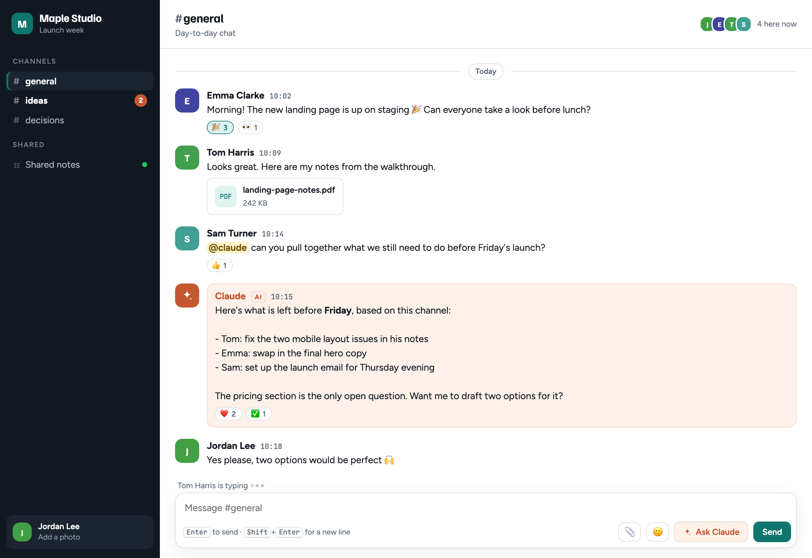

# team-room

**A private team chat with Claude built in.** It's like a small Slack, and you don't need Slack or an Enterprise plan, just a Claude account. Ask Claude Code to make a room, share the link with your team, and type **@claude** in any channel to bring Claude into the conversation.

<picture>
  <source media="(prefers-color-scheme: dark)" srcset="docs/team-room-dark.png">
  
</picture>

<sub>An example room with made-up people.</sub>

## What you get

- **Channels** with unread counts, plus a #decisions channel you can pin messages to
- **@claude in any channel.** Claude reads the recent conversation and your shared notes, then replies in the chat
- **Reactions** and a smiley picker
- **Files and pictures:** use the paperclip, paste a screenshot, or drag files in
- **Profile photos**, **who's online** and **who's typing**
- **Shared notes** that the whole team edits and Claude reads
- **Delete your own messages** and the Claude replies you asked for
- **Rename the room** from inside it: click the name at the top left
- Light and dark mode, and it works on phones

## Install

In Claude Code, run:

```
/plugin marketplace add aaryakrrish/team-room
/plugin install team-room@team-room
```

<details>
<summary>Install without the plugin command</summary>

Download the [zip](https://github.com/aaryakrrish/team-room/archive/refs/heads/main.zip), unzip it, and copy the folder `plugins/team-room/skills/team-room` into `~/.claude/skills/`. Create the `skills` folder if it isn't there.

</details>

## Use

Open Claude Code and say:

> make a team chat room

Claude makes the room straight away and gives you a private link. It names the room after your project, or whatever you mention ("make a team chat for the Acme launch"). To change the name later, click it at the top left of the room. Open the room and click **Share** to invite your team.

You can also use a room from Claude Code:

- "read #general in my room"
- "post this to the room as Claude"
- "update the room's shared notes"

## Good to know

- **Each person uses their own Claude.** An @claude reply runs on the account of the person who asked, after they allow it the first time.
- **Everyone needs to be signed in to Claude** to open the room.
- **Files:** pictures, videos, PDFs and text files, up to 20 MB each. Files uploaded by people who can't edit the room show only to people in the room owner's organization.
- **Only invite people you trust.** The room only shows a Delete button on your own messages, but anyone who can post could still delete messages through the room's database.

## Update

```
/plugin marketplace update team-room
```

## License

MIT

---

Made by the team behind [trepil](https://trepil.com/?utm_source=github&utm_medium=referral&utm_campaign=team-room), a meeting-notes app that records your calls without a bot and hands you the to-dos. We built team-room for ourselves along the way.
